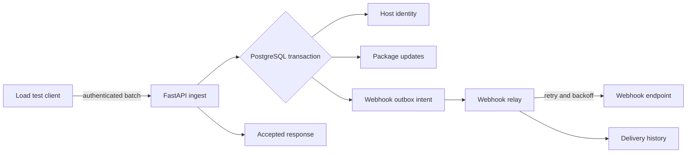

# Backend Ingest Throughput and Webhook Reliability

> **PRD-BACKEND-INGEST-THROUGHPUT** | Status: draft | Version: 0.2.0 | Last Updated: 2026-10-22

## Executive Summary

Fluxion must process package-update batches efficiently enough to support fleet reporting without replacing PostgreSQL or rewriting the backend. This PRD establishes database indexes, bulk database writes, durable webhook delivery, connection-pool behavior, and repeatable batch-ingestion load testing as implementation requirements.

The current backend inserts package-update rows one at a time and sends webhooks after the package transaction using FastAPI background tasks. A process restart can interrupt queued webhook work, and database pool behavior is not tied to a measured load profile. The release must establish a measured baseline and optimize the existing Python/FastAPI implementation before considering a language rewrite.

## Product Context

The package-update ingest API is used by Linux hosts to report package changes, package-manager activity, and security classifications. Its writes feed host health, package history, security feeds, analytics, exports, webhook notifications, and retention operations.

The current deployment uses PostgreSQL 18 and Kubernetes-style replicas with SQLAlchemy async sessions. The implementation should improve existing behavior without changing the package-ingestion contract or migration ownership of PostgreSQL.

## Users and Personas

- **Fleet operator:** Reviews host activity and security updates and expects batch reports to be accepted without sustained latency or duplicate package history.
- **Platform administrator:** Operates Fluxion replicas, PostgreSQL, webhook endpoints, migrations, and database connection limits.
- **Linux host:** Sends a batch containing package changes and requires a successful response only after the package transaction commits.
- **Webhook consumer:** Receives package, kernel, security, and install events with retry semantics and delivery history.
- **Engineering maintainer:** Runs repeatable load tests and interprets PostgreSQL query plans, pool metrics, and ingest latency.

## Design Decisions

- **DD-001:** Keep the existing Python/FastAPI backend and PostgreSQL schema for this release.
- **DD-002:** Use actual API query patterns and PostgreSQL `EXPLAIN` plans to justify index additions.
- **DD-003:** Persist package writes atomically and insert package-update rows as a bounded bulk operation.
- **DD-004:** Use a PostgreSQL transactional outbox for webhook durability or retain the decision gate until an equivalent durable queue is selected and reviewed.
- **DD-005:** Measure database pool behavior from the application and load-test configuration; do not infer capacity from defaults alone.
- **DD-006:** Do not rewrite any backend component in Rust under this PRD. Rust remains a separate evaluation based on measured evidence.

## Product Goals

- **GOAL-001:** Reduce batch-ingestion database latency by at least 30 percent compared with the measured pre-change baseline within one implementation release.
  - Priority: MUST
  - KPI: 95th-percentile batch request latency during the standard load profile.
- **GOAL-002:** Preserve every accepted package event's webhook intent across API process restarts and relay failures within one implementation release.
  - Priority: MUST
  - KPI: 100 percent of committed package events with configured matching webhooks are represented by durable pending or delivered state; exact delivery outcome is recorded per webhook.
- **GOAL-003:** Establish and automate a repeatable batch-ingestion load profile within one implementation release.
  - Priority: MUST
  - KPI: One command produces request rate, throughput, error rate, latency percentiles, pool wait data, and PostgreSQL utilization for the standard profile.

**SMART Evaluation** (assessed at Validate to Finalize gate):

- [ ] **S**pecific: Goal statements identify latency, webhook durability, and evidence outputs.
- [ ] **M**easurable: Each goal includes an exact percentage, completion invariant, or produced artifact.
- [ ] **A**chievable: The implementation changes existing database, queue, pool, and test surfaces rather than replacing the platform.
- [ ] **R**elevant: All goals address throughput and reliability bottlenecks before a backend language rewrite.
- [ ] **T**ime-bound: Each goal applies within one implementation release.

**Status**: deferred until implementation evidence is available.

## Functional Requirements

- **FR-001: Database index review and migration.**
  - Actor: Platform administrator
  - Trigger: PostgreSQL query plans or repeated API queries are measured against a representative data set.
  - Expected Outcome: Each added index is justified by an affected query pattern, supplied through a reversible Alembic migration, and absent from production until migration succeeds.
  - Acceptance Criteria: AC-001, AC-002, AC-003
- **FR-002: Bulk package-update writes.**
  - Actor: Linux host
  - Trigger: The host posts a batch to `/api/v1/updates/batch` or `/api/v1/updates/ingest/{package_manager}`.
  - Expected Outcome: The batch host upsert and all package-update rows are written in one database transaction using bounded bulk SQL.
  - Acceptance Criteria: AC-004, AC-005, AC-006
- **FR-003: Durable webhook intent.**
  - Actor: Batch-ingest API
  - Trigger: A package transaction commits package updates that match one or more webhook event types.
  - Expected Outcome: Each matched webhook delivery is represented by durable state in the same database transaction that commits the package updates.
  - Acceptance Criteria: AC-007, AC-008, AC-009
- **FR-004: Webhook relay and retry handling.**
  - Actor: Webhook delivery worker or relay
  - Trigger: Durable webhook intent is pending, is retryable, or encounters an API restart.
  - Expected Outcome: The relay claims bounded work, attempts delivery, records terminal outcomes, retries with backoff, and resumes pending work after restart.
  - Acceptance Criteria: AC-010, AC-011, AC-012
- **FR-005: Connection-pool configuration.**
  - Actor: Platform administrator
  - Trigger: Fluxion starts one or more API replicas.
  - Expected Outcome: The SQLAlchemy pool uses measured, bounded settings and exposes checkout saturation, overflow, and connection recycle behavior.
  - Acceptance Criteria: AC-013, AC-014, AC-015
- **FR-006: Batch-ingestion load profile.**
  - Actor: Engineering maintainer
  - Trigger: A backend change affects ingestion, database access, webhooks, or connection pooling.
  - Expected Outcome: A repeatable load test sends authenticated batch requests and reports throughput, latency, errors, pool behavior, and database utilization against a fixed setup.
  - Acceptance Criteria: AC-016, AC-017, AC-018

## Non-Functional Requirements

### Performance and Capacity

- **NFR-001:** Under the standard profile of 50 concurrent clients, 100-package batches, and 10 minutes of sustained traffic, the batch API must meet the baseline-derived latency target and produce no more than 1 percent HTTP 5xx responses.
- **NFR-002:** Under the standard profile, package inserts must not exceed one database round trip per row. Bulk insert statements may use vendor-specific executemany behavior but must be bound by the batch size contract.
- **NFR-003:** The test database data set must contain at least 1,000 hosts and 1,000,000 package-update rows to exercise index behavior and paging.

### Reliability and Resilience

- **NFR-004:** A package transaction and its durable webhook intent are committed atomically. A package rollback must leave no accepted package rows and no durable webhook intent for that rollback.
- **NFR-005:** Webhook relay recovery after process restart must claim and retry every pending relay row without manual database edits.
- **NFR-006:** Repeated relay attempts for the same delivery identity must not create duplicate package-update rows or accepted ingest records.

### Security

- **NFR-007:** Bulk ingest and load-test endpoints must continue to require the existing API-key authentication and role behavior.
- **NFR-008:** Webhook queue records must not write secret values from `headers_json` into plaintext delivery logs or traces.
- **NFR-009:** Load-test credentials and generated API keys must be injected through environment variables or secrets and must not be committed.

### Scalability and Elasticity

- **NFR-010:** The pool configuration must remain valid from 1 replica through 10 replicas without exceeding the PostgreSQL configured maximum connection count.
- **NFR-011:** The webhook relay must process a bounded claim size and must not increase database connection use beyond its configured worker pool.

### Maintainability and Operability

- **NFR-012:** Database index additions and removals must be reversible Alembic migrations.
- **NFR-013:** Pool and webhook tuning values must be configurable through environment variables and Helm values rather than source-code constants.
- **NFR-014:** The load-test command must accept target URL, API key, client count, batch size, and duration as explicit parameters.

### Observability

- **NFR-015:** Batch ingest must emit counts for accepted package rows, rejected package rows, database transaction duration, and 95th-percentile request duration.
- **NFR-016:** The database pool must expose active, idle, overflow, and waited-for-checkout values through logs or metrics.
- **NFR-017:** The webhook relay must emit pending, claimed, delivered, retrying, and dead-terminal counts plus delivery attempt latency.

### Compatibility and Interoperability

- **NFR-018:** Existing APT, dnf, yum, apk, and zypper ingest contracts must remain compatible with normalized batch behavior.
- **NFR-019:** PostgreSQL remains the relational system of record. No Redis, broker, or Rust dependency is added solely for this PRD.

## Constraints

- **CON-001:** The production backend runtime remains Python 3.11 or later.
  - Imposing source: Existing backend project and deployment
  - Affected boundary: Runtime
  - Non-negotiability: This PRD does not authorize a backend language rewrite.
  - Category: Technical
  - Impact: Implementation is constrained to the FastAPI, SQLAlchemy, and Alembic stack.
- **CON-002:** PostgreSQL is the source of truth for package updates and webhook delivery state.
  - Imposing source: Existing Fluxion architecture
  - Affected boundary: Integration
  - Non-negotiability: Durable state cannot live only in process memory.
  - Category: Technical
  - Impact: Queue state requires schema migration and database transactions.
- **CON-003:** Existing API paths and authentication responses remain compatible.
  - Imposing source: Fleet clients and existing tests
  - Affected boundary: API contract
  - Non-negotiability: The optimization changes implementation, not the endpoint contract.
  - Category: Technical
  - Impact: Load-test and bulk-write changes preserve path, method, status, and response shape.
- **CON-004:** Implementation stories remain under 300 changed lines unless the pipeline approves a split.
  - Imposing source: Repository AI-SDLC policy
  - Affected boundary: Delivery
  - Non-negotiability: Cross-cutting scope must be split by dependency.
  - Category: Schedule
  - Impact: Separate migration, bulk-write, queue, pool, and load-test stories are required.

## Process Models

## Acceptance Criteria

- **AC-001:** Given a representative 1,000-host and 1,000,000-row PostgreSQL data set, when the existing host-history, package-history, security, analytics, and webhook queries are explained, then every new migration index is used or justified by a recorded query-plan outcome and no duplicate index is created.
  - Covers: FR-001
  - Status: Not Started
- **AC-002:** Given the Alembic migration containing database indexes, when `alembic upgrade head` is run, then all named indexes exist and migration completeness is verified by the migration test.
  - Covers: FR-001
  - Status: Not Started
- **AC-003:** Given the same migration, when `alembic downgrade` rolls it back, then all migration-created indexes are removed and an existing schema state is restored without dropping package, host, or webhook data.
  - Covers: FR-001
  - Status: Not Started
- **AC-004:** Given a valid batch with 100 package items, when `/api/v1/updates/batch` processes it, then one host identity and exactly 100 package-update rows are persisted in a single committed transaction.
  - Covers: FR-002
  - Status: Not Started
- **AC-005:** Given a batch containing two package items with the same package name and version, when processing succeeds, then both package rows remain distinguishable by their identity and update timestamp and no row is silently deduplicated.
  - Covers: FR-002
  - Status: Not Started
- **AC-006:** Given a database error on the 100th package item or host write, when the transaction fails, then the API returns HTTP 500, commits zero package rows, commits zero webhook intents, and rolls back the database session.
  - Covers: FR-002
  - Status: Not Started
- **AC-007:** Given a package batch matching one or more webhook event types, when the package transaction commits, then the transaction also persists one durable intent for each exact webhook configuration and event type pair.
  - Covers: FR-003
  - Status: Not Started
- **AC-008:** Given a package transaction that rolls back, when webhook intent insertion is also attempted, then zero webhook intent rows exist for that transaction identity.
  - Covers: FR-003
  - Status: Not Started
- **AC-009:** Given a repeated batch with the same delivery identity, when relay processing is retried, then package rows are not duplicated by a delivery replay and the delivery history state remains consistent.
  - Covers: FR-003
  - Status: Not Started
- **AC-010:** Given a pending webhook intent, when the relay runs, then it claims at most its configured batch limit and sends at most one in-flight delivery per claimed identity.
  - Covers: FR-004
  - Status: Not Started
- **AC-011:** Given a webhook endpoint that returns HTTP 500 for attempts 1 and 2 and HTTP 204 for attempt 3, when relay processing runs, then the delivery is recorded as successful on attempt 3 and no fourth HTTP request is sent.
  - Covers: FR-004
  - Status: Not Started
- **AC-012:** Given an API or relay restart with 1,000 pending intents and 1,000 terminal intents, when the relay starts, then it retries exactly the pending and retryable intents and does not resend terminal intents.
  - Covers: FR-004
  - Status: Not Started
- **AC-013:** Given the pool is configured below its PostgreSQL maximum connection budget, when one API replica starts, then its pool size plus overflow never exceeds the replica allocation for the active replica count.
  - Covers: FR-005
  - Status: Not Started
- **AC-014:** Given a database connection becomes unavailable, when the pool pre-ping detects it, then the API replaces the stale connection and a subsequent valid request succeeds.
  - Covers: FR-005
  - Status: Not Started
- **AC-015:** Given every configured database connection is occupied for longer than the pool checkout timeout, when another request arrives, then the API returns a bounded pool-error response instead of waiting indefinitely and emits checkout-wait metrics.
  - Covers: FR-005
  - Status: Not Started
- **AC-016:** Given the standard load profile executes for 10 minutes against the fixed 1,000-host and 1,000,000-row data set, then the runner produces request count, package count, throughput, HTTP error count, p50 latency, p95 latency, p99 latency, pool waits, and database utilization in machine-readable JSON and human-readable summary output.
  - Covers: FR-006
  - Status: Not Started
- **AC-017:** Given the standard profile is run before and after the implementation, then the post-change p95 latency is at least 30 percent lower or a documented risk waiver records why the target is not met.
  - Covers: FR-006
  - Status: Not Started
- **AC-018:** Given the standard profile is run twice with identical parameters, then the resulting JSON reports the same configuration and test data version and no test-only package data remains after cleanup.
  - Covers: FR-006
  - Status: Not Started

## Traceability Matrix

### FR-to-AC Coverage

| FR | AC |
|---|---|
| FR-001 | AC-001, AC-002, AC-003 |
| FR-002 | AC-004, AC-005, AC-006 |
| FR-003 | AC-007, AC-008, AC-009 |
| FR-004 | AC-010, AC-011, AC-012 |
| FR-005 | AC-013, AC-014, AC-015 |
| FR-006 | AC-016, AC-017, AC-018 |

Coverage formula: `(count of FR rows with one or more AC links / count of FR rows) * 100`.

Current coverage: 100 percent. Default threshold: 100 percent.

### FR-to-GOAL Alignment

| FR | GOAL |
|---|---|
| FR-001, FR-002, FR-005, FR-006 | GOAL-001 |
| FR-003, FR-004 | GOAL-002 |
| FR-006 | GOAL-003 |

Coverage formula: `(count of FR rows with one or more GOAL links / count of FR rows) * 100`.

Current coverage: 100 percent. Default threshold: 100 percent.

## MVP and Release Framing

The first release is implementation of database index migrations, bounded bulk package writes, the transactional webhook outbox or selected durable equivalent, pool metrics and tuning, and the standard load-test runner. Rust is explicitly outside this release.

Deferred work includes a Rust feasibility spike, distributed queue infrastructure, a replacement ORM, and backend runtime migration.

## Success Metrics

- **Metric:** Batch ingest p95 latency
  - Baseline: measured by AC-016 before implementation
  - Target: at least 30 percent reduction under the standard profile
  - Window: 10-minute sustained load test
  - Data source: load-test runner and FastAPI telemetry
  - Linked goal: GOAL-001
- **Metric:** Accepted webhook intent durability
  - Baseline: process-memory delivery gaps identified before implementation
  - Target: 100 percent of committed matching package events represented in durable pending, delivered, retrying, or terminal state
  - Window: restart and relay retry scenarios
  - Data source: PostgreSQL webhook and delivery-state tables
  - Linked goal: GOAL-002
- **Metric:** Load-test repeatability
  - Baseline: no automated standard profile
  - Target: one machine-readable report per run with identical parameter and data-set metadata for repeated runs
  - Window: every backend ingestion change
  - Data source: load-test runner output
  - Linked goal: GOAL-003

## Risks and Assumptions

### Key Assumptions

| ID | Assumption | Evidence status | Impact if false | Mitigation | Source |
|---|---|---|---|---|---|
| A-001 | PostgreSQL is the primary ingestion bottleneck before application CPU or network. | Untested | Rust benchmark evidence could remain unrelated to the actual bottleneck. | Run the standard profile, collect query plans and pool metrics, and compare database and application time. | Existing PostgreSQL deployment |
| A-002 | The existing batch contract can accept bulk SQL changes without changing response values. | Partially supported | Client integrations or tests could break. | Preserve endpoint schemas and add contract tests. | Existing package schemas |
| A-003 | A PostgreSQL outbox is sufficient for webhook delivery volume. | Untested | Relay polling could become a hot path. | Measure queue depth and relay throughput; select a broker only if evidence requires it. | Existing outbox guidance |

### Research Finding Dispositions

| Gap ID | Evidence IDs | Affected targets | Disposition | Rationale | Primary research artifact |
|---|---|---|---|---|---|
| G-001 | Repository code inspection | FR-001, FR-002, FR-005 | Incorporated | Batch writes and representative query paths are present in the implementation. | `backend/fluxion/api/routes/updates.py`, `backend/fluxion/database/connection.py` |
| G-002 | Repository code inspection | FR-003, FR-004 | Incorporated | Webhooks currently rely on FastAPI background tasks and delivery history. | `backend/fluxion/services/webhook_service.py` |
| G-003 | Repository implementation plan | FR-003, FR-004 | Retained-gap | A transactional outbox design exists in a prior plan but is not verified as implemented. | `docs/superpowers/plans/2026-07-24-dapr-adoption.md` |

### Risk Register

- **RISK-001: Added indexes consume excess write and storage capacity.**
  - Probability: Medium
  - Impact: Medium
  - Mitigation: Add only indexes supported by measured query plans; verify write cost in migration and load tests.
- **RISK-002: Bulk writes exceed transaction memory or lock duration.**
  - Probability: Medium
  - Impact: High
  - Mitigation: Bound batch size, preserve transaction atomicity, and add rollback and timeout behavior.
- **RISK-003: Webhook relay duplicates delivery attempts under crash timing.**
  - Probability: High
  - Impact: Medium
  - Mitigation: Use stable delivery identity, claim state, and idempotent delivery-history semantics.
- **RISK-004: Pool allocation exceeds PostgreSQL maximum connections across replicas.**
  - Probability: Medium
  - Impact: High
  - Mitigation: Derive pool totals from replica count and PostgreSQL maximum connections and expose saturation metrics.
- **RISK-005: Load-test data masks production patterns.**
  - Probability: Medium
  - Impact: High
  - Mitigation: Use fixed distributions, representative host counts, package names, and query filters documented with each run.

## Glossary

- **Batch ingest:** One API request that records one host and a list of package changes.
- **Bulk write:** A database operation that writes multiple package rows with bounded SQL execution rather than one ORM flush per row.
- **Outbox intent:** A durable database record representing a webhook delivery that must be claimed and attempted.
- **Pool checkout:** Allocation of one SQLAlchemy/PostgreSQL connection to a database session.
- **Standard load profile:** 50 concurrent clients, 100-package batches, 10 minutes, 1,000 hosts, and 1,000,000 package-update rows.
- **Transactional outbox:** Durable queue records committed in the same database transaction as the business state they represent.

## Sign-Off

### Approval Checklist

- Product Sponsor: Wesley Backelant - Approves product opportunity and strategic alignment.
- Product Owner: Wesley Backelant - Approves requirements completeness and feasibility.
- Technical Lead: Neo - Approves technical feasibility and constraints.
- Quality Lead: Trinity - Approves quality criteria and acceptance test coverage.
- Legal/Compliance: Not required - No external legal or regulatory processing requirement identified.

Approval date: Pending

### Waivers

No waivers are active at draft creation.

### Handoff Readiness

This draft requires implementation decomposition after the PRD is approved. Candidate stories must cite FR and AC identifiers and remain dependency ordered by migration, bulk-write, queue, pool, and load-test evidence.

## Disclaimer

This PRD defines implementation requirements for existing Fluxion architecture. Runtime and database targets require the standard load profile and a measured baseline before implementation claims are evaluated.

## Document Metadata

- Template Version: 1.0.0
- Canonical Template: `docs/templates/prd-template.md`
- License: CC-BY 4.0 (Microsoft HVE-Core)

## Design Decisions

| ID | Decision |
| --- | --- |
| DD-001 | Add an allowed-host list to each API key; user keys may submit a batch only for hostnames in the exact allowlist and admin keys may submit only when the existing admin role policy authorizes the target hostname. An API key that does not authorize a requested hostname returns HTTP 403 exactly and creates zero package and outbox rows. |
| DD-002 | Treat PostgreSQL max_connections as 100. Reserve 20 connections for migrations, administrators, and maintenance, then allocate the remaining 80 connections across API and relay replicas. For up to 10 API replicas and one relay replica, each API replica uses pool_size plus max_overflow no greater than 8, and the relay worker pool uses no more than 8 connections; total application connections never exceed 80. Missing or aggregate-invalid configuration stops startup. |
